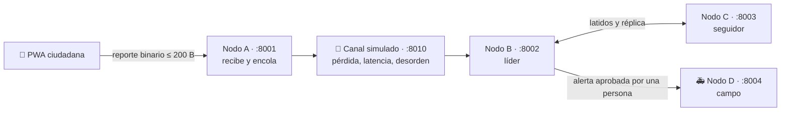

<div align="center">

# 🆘 SARD

### Reportes de emergencia que llegan aunque no haya señal

Un ciudadano reporta en **2 a 4 toques**, sin registrarse y sin conexión.<br>
La central prioriza, agrupa y recomienda. **Una persona siempre decide.**

<br>

<a href="https://github.com/mduquegi"></a>
&nbsp;&nbsp;&nbsp;
<a href="https://github.com/mgama-sketch"></a>
&nbsp;&nbsp;&nbsp;
<a href="https://github.com/Dfill-16"></a>

**[@mduquegi](https://github.com/mduquegi)** · **[@mgama-sketch](https://github.com/mgama-sketch)** · **[@Dfill-16](https://github.com/Dfill-16)**

<br>


[Qué es](#-qué-es) · [Cómo funciona](#-cómo-funciona) · [Instalación](#-instalación-en-5-minutos) · [Demo](#-guion-de-demostración) · [Pruebas](#-pruebas)

</div>

---

## 🌧️ Qué es

En Manizales, una lluvia fuerte puede causar a la vez deslizamientos, inundaciones **y** la caída de la red celular. Justo cuando más gente necesita pedir ayuda, menos mensajes logran salir.

SARD es un sistema de reporte y coordinación de emergencias pensado para ese momento:

<table>
<tr>
<td width="33%" valign="top">

### 📱 PWA ciudadana
Elige qué pasa, marca lo urgente y envía. **Funciona sin señal**: el reporte se guarda en el teléfono y sale solo cuando vuelve la conexión.

Es **anónima**: no pide nombre, teléfono ni documento.

</td>
<td width="33%" valign="top">

### 🗺️ Tablero de coordinación
Cola priorizada de P1 a P4, mapa con la **confianza** de cada incidente, brechas de cobertura, contradicciones y el rastro en el log.

El coordinador **aprueba o descarta** cada recomendación.

</td>
<td width="33%" valign="top">

### 🚑 Vista de campo
Las unidades reciben solo las alertas **aprobadas por una persona** y confirman con un botón «Recibido».

La central ve cuánto tardó el acuse.

</td>
</tr>
</table>

### 💡 Lo que nos importa

| | |
|---|---|
| 🔍 **Nada se oculta** | Los reportes de baja prioridad o sin ubicación siempre aparecen, con su conteo. |
| 🧑‍⚖️ **La IA sugiere, la persona decide** | El LLM es opcional: solo puede *subir* una prioridad o redactar un texto. Sin él, todo funciona por reglas. |
| 🔁 **Resiste fallas** | Si cae el nodo líder, el seguidor asume en unos 10 s. Al volver, unen sus registros sin perder nada. |
| 🔗 **Trazable** | Todo queda en un log de eventos solo de escritura, encadenado con hashes. |
| ♿ **Incluyente** | Español e inglés, dictado de la nota, lectura en voz alta, vibración, lectores de pantalla (TalkBack, VoiceOver) y botones grandes. |

---

## ⚙️ Cómo funciona

SARD simula en un solo computador los nodos de un despliegue real. Cada nodo es la misma aplicación Laravel con un rol distinto y su propia base SQLite.



<details>
<summary><b>🤖 Los seis agentes</b></summary>

<br>

| Agente | Dónde | Qué hace | ¿Usa LLM? |
|---|---|---|---|
| **A1** Recepción | Líder | Normaliza el reporte sin inventar datos | No |
| **A2** Triaje | Líder | Asigna P1 a P4 por reglas y calcula la incertidumbre | Opcional: solo sugiere *subir* la prioridad |
| **A3** Correlación | Líder | Agrupa reportes cercanos (DBSCAN); detecta incidentes masivos y posibles rumores | No |
| **A4** Comunicación | Nodo A | Cola con prioridad y reintentos (1-2-4-8-16-30 s) hasta recibir el ACK | No |
| **A5** Resiliencia | B y C | Latidos, failover por época, réplica y unión del log al reconectar | No |
| **A6** Coordinación | Líder | Recomienda la unidad disponible más cercana; la alerta solo sale tras una decisión humana | Opcional: redacta la justificación |

</details>

<details>
<summary><b>🧰 Tecnologías</b></summary>

<br>

Laravel 13 · PHP 8.3+ · SQLite (WAL) · Blade + Alpine.js · Tailwind CSS v4 · Leaflet + PMTiles de Protomaps (mapa sin conexión) · Vite · PHPUnit · `node --test`

</details>

---

## 🚀 Instalación en 5 minutos

> **Necesitas:** PHP 8.3 o superior con `pdo_sqlite` (usamos PHP 8.5 con [Laravel Herd](https://herd.laravel.com)), Composer 2, Node.js 22 o superior y PowerShell.
> Los scripts se probaron en Windows; en macOS o Linux puedes intentar con PowerShell 7 (`pwsh`).

**1. Clona el repositorio**

```bash
git clone https://github.com/Dfill-16/sard_hackaton.git
```

```bash
cd sard_hackaton
```

**2. Instala todo de una vez**

```bash
composer setup
```

Instala las dependencias de PHP y Node, crea el `.env`, genera la clave, corre las migraciones y compila los estilos. El mapa de Manizales y Villamaría ya viene en el repositorio.

**3. Enciende los nodos**

```bash
./scripts/start.ps1 -Fresco
```

`-Fresco` empieza con bases vacías; sin él, conservas los datos anteriores.

**4. Abre las vistas**

| | Vista | URL |
|---|---|---|
| 📱 | PWA ciudadana | http://127.0.0.1:8001/pwa |
| 🗺️ | Tablero (líder B) | http://127.0.0.1:8002/tablero |
| 🗺️ | Tablero (seguidor C) | http://127.0.0.1:8003/tablero |
| 🚑 | Vista de campo | http://127.0.0.1:8004/campo |

**5. Llena el mapa con datos de demostración** *(opcional)*

```bash
php artisan db:seed --class=ReportesDemoSeeder
```

Envía 64 reportes ficticios por el mismo camino que la PWA: casos P1, un incidente masivo, un posible rumor, una brecha de cobertura, una contradicción y reportes sin ubicación. Tardan de 1 a 4 minutos en llegar todos.

Para apagar todo:

```bash
./scripts/stop.ps1
```

<details>
<summary><b>🧠 Activar el LLM (opcional)</b></summary>

<br>

SARD funciona completo sin LLM («modo reglas»). Para activarlo, completa en tu `.env` (nunca en el repositorio) hasta tres proveedores gratuitos compatibles con la API de OpenAI. Se prueban en orden; si todos fallan, se sigue por reglas.

```dotenv
LLM_HABILITADO=true
LLM_TIMEOUT_S=5
LLM_1_URL=https://generativelanguage.googleapis.com/v1beta/openai
LLM_1_KEY=tu-clave-de-google-ai-studio
LLM_1_MODELO=gemini-3.5-flash-lite
LLM_2_URL=https://openrouter.ai/api/v1
LLM_2_KEY=tu-clave-de-openrouter
LLM_2_MODELO=nvidia/nemotron-3.5-super-vl:free
LLM_3_URL=https://integrate.api.nvidia.com/v1
LLM_3_KEY=tu-clave-de-nvidia-nim
LLM_3_MODELO=nvidia/nemotron-3.5-lightning-30b-a3b
```

Comprueba cada proveedor sin mostrar las claves:

```bash
php artisan sard:llm-probar
```

Al LLM solo se le envían datos del reporte (tipo, banderas, personas y nota), nunca el identificador del dispositivo.

</details>

<details>
<summary><b>🎲 Generar tus propios reportes</b></summary>

<br>

```bash
php artisan sard:sembrar 40 --masivo --rumor
```

Opciones: cantidad de reportes, `--masivo`, `--rumor`, `--demo`, `--dispositivos=N`, `--sin-ubicacion=0.1` y `--semilla=42`.

</details>

---

## 🎬 Guion de demostración

| # | Momento | Qué hacer | Qué se ve |
|---|---|---|---|
| 1 | 📵 **Sin señal** | En la PWA activa «Simular sin red» y envía un reporte | Queda «Pendiente». Al desactivarlo, se envía solo y pasa a «Recibido por la central» |
| 2 | 🚦 **Priorizar** | Abre el tablero y toca un P1 | Reportes originales, confianza, fuentes y rastro en el log |
| 3 | ✅ **Decidir** | Escribe tu nombre en «Operador» y aprueba | La alerta llega a la vista de campo; al tocar «Recibido», el tablero muestra el acuse |
| 4 | 💥 **Cae el líder** | `./scripts/matar-nodo.ps1 B` | El tablero pasa solo a C, que asume en unos 10 s |
| 5 | 🔄 **Vuelve** | `./scripts/start.ps1 -Nodos B` | B se une sin perder eventos |

### 📋 Documentación y entregables

| Entregable | Estado | Archivo |
|---|---|---|
| E1 | ✅ | Prototipo funcional |
| E2 | ✅ | Código fuente en este repo |
| E3 | ✅ | `docs/e3/index.html` (arquitectura) |
| E4 | ✅ | `docs/fichas/` (6 fichas JSON + schema) |
| E5 | ✅ | `docs/e5/entregable-5-protocolo.md` |
| E6 | ✅ | `docs/resultados/resultados.md` (métricas) |
| E7 | ⚠️ | `scripts/demo.ps1` (falta pitch formal)

<details>
<summary><b>🔗 Verificar la integridad del log</b></summary>

<br>

En PowerShell, apuntando a la base del nodo:

```powershell
$env:NODE_ROLE = 'B'; $env:DB_DATABASE = "$PWD/database/nodo_b.sqlite"; php artisan sard:verificar-log B
```

</details>

---

## 🧪 Pruebas

```bash
php artisan test --compact
```

```bash
node --test tests/js/ resources/js/protocol/
```

Cubren el protocolo binario (con un fixture compartido entre PHP y JS), los agentes, el canal con pérdida y multisalto, el failover y la unión de nodos, el LLM con proveedores simulados, el tablero, la PWA, la accesibilidad y las traducciones.

<details>
<summary><b>📁 Estructura del proyecto</b></summary>

<br>

```
app/Agents/        Agentes A1–A6
app/Node/          Controladores por nodo (A: PWA y reportes, B/C: líder, D: campo)
app/Protocol/      Codec binario del reporte (≤ 200 B)
app/Sard/          Log de eventos, proyecciones, reglas, canal y cadena LLM
resources/views/   Tablero, PWA y vista de campo (Blade + Alpine)
resources/js/      Lógica del tablero, la PWA (cola sin conexión, accesibilidad) e idiomas
scripts/           Arranque, parada y caída simulada de nodos
tests/             Pruebas PHP y JS
```

</details>

---

## 🔒 Privacidad

- 🙈 La PWA no pide datos personales: el teléfono se identifica solo con un código al azar.
- 🧪 Todos los datos de demostración (reportes, unidades, albergues) son ficticios.
- 🔑 Las claves de los LLM viven solo en tu `.env` local.

---

<div align="center">

Hecho con ❤️ para Manizales por **[@mduquegi](https://github.com/mduquegi)**, **[@mgama-sketch](https://github.com/mgama-sketch)** y **[@Dfill-16](https://github.com/Dfill-16)**

<sub>Mapa © <a href="https://www.openstreetmap.org/copyright">OpenStreetMap</a> · <a href="https://protomaps.com">Protomaps</a></sub>

</div>
